<div align="center">

# Folio

**Your reading life, beautifully connected.**

A native Mac reading library, analytics studio and personal knowledge vault, with optional AI that only cites what you actually wrote.


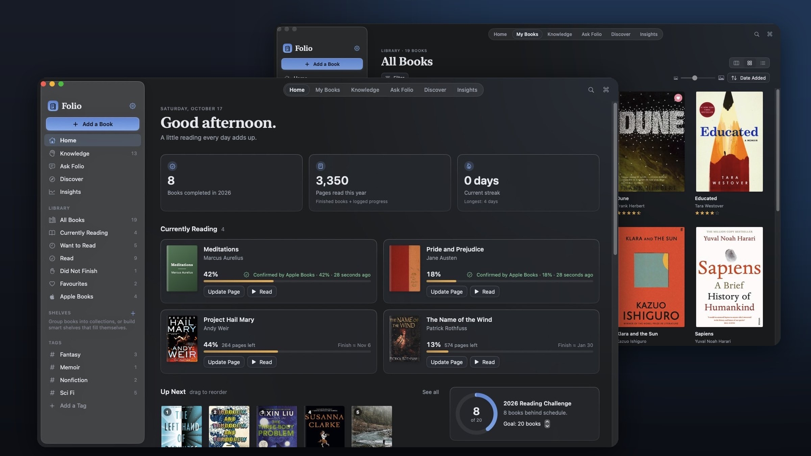

<sub>All screenshots are from the real running app, using an isolated demo library with sample data.</sub>

</div>

---

## Why Folio

Goodreads records **what** you read. Folio is built to help you remember **what you learned from it**.

| | Goodreads | Folio |
|---|---|---|
| Where it runs | Web and mobile, account required | Native Mac app; your data stays in one local file |
| Progress | Typed in by hand | Reading sessions, plus **confirmed progress from Apple Books** |
| Notes | Basic highlights | A knowledge vault: highlights, lessons, mental models and questions, all linked |
| Insights | A yearly count | Pace, streaks, a heatmap, and forecasts with uncertainty ranges |
| Discovery | Popularity lists | Explainable recommendations, each verified against Open Library |
| AI | None | Optional and private. Answers are grounded in your notes, and every citation is checked |

## A look inside

<table>
<tr>
<td width="50%">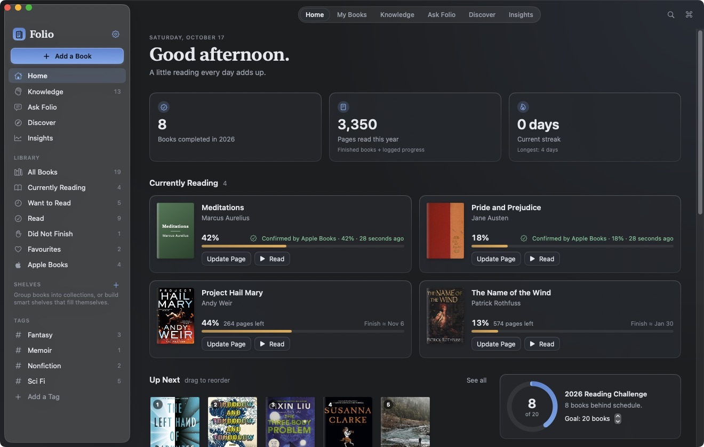<br><b>Home:</b> currently reading, a reading heatmap, Up Next and recent knowledge.</td>
<td width="50%">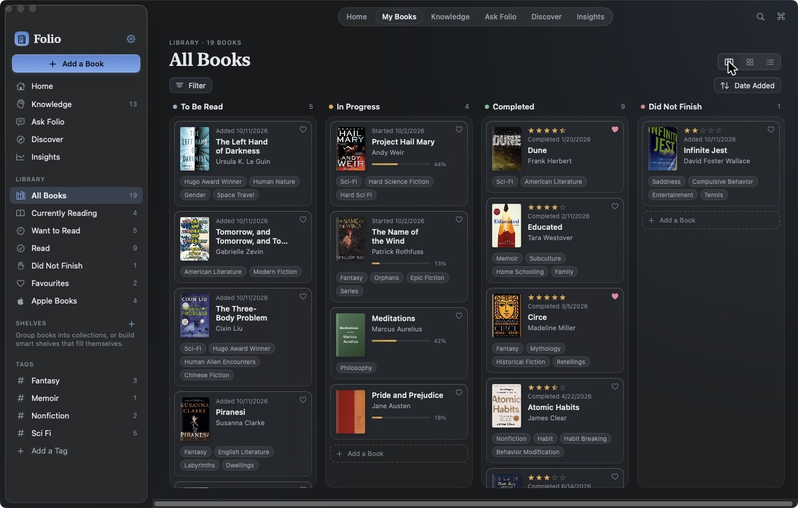<br><b>Library board:</b> drag books between Want, Reading, Read and DNF.</td>
</tr>
<tr>
<td>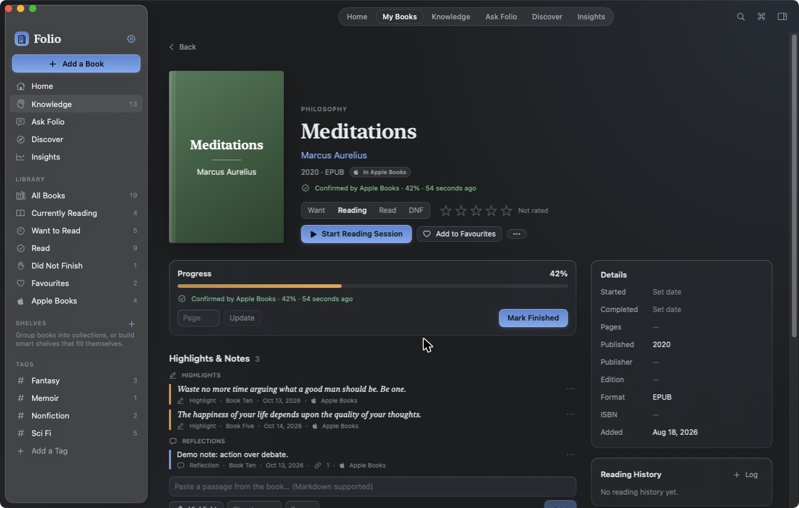<br><b>Apple Books sync:</b> confirmed progress and imported highlights, with their source shown.</td>
<td>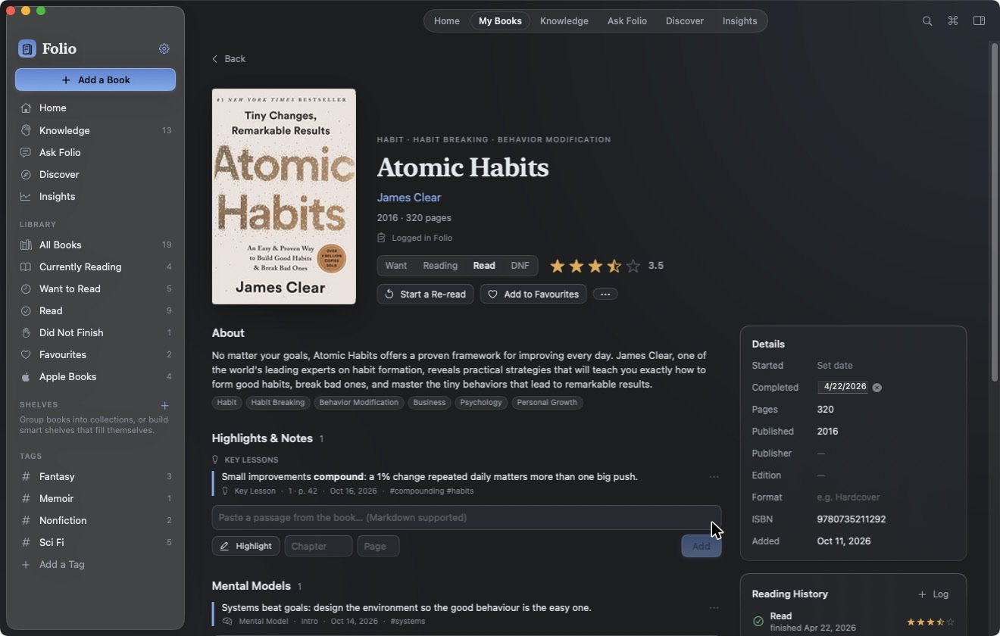<br><b>Book pages:</b> progress, sessions, rereads, notes and related books.</td>
</tr>
<tr>
<td>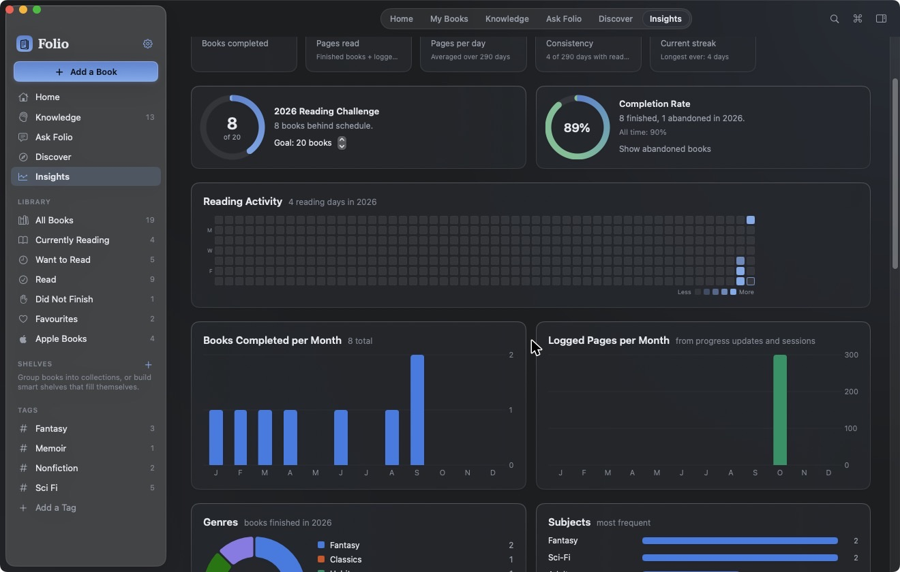<br><b>Insights:</b> pace, consistency, genres and a full-year heatmap.</td>
<td>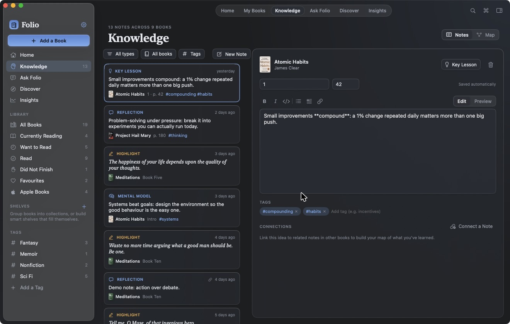<br><b>Knowledge vault:</b> typed notes in Markdown, with tags and links between them.</td>
</tr>
<tr>
<td>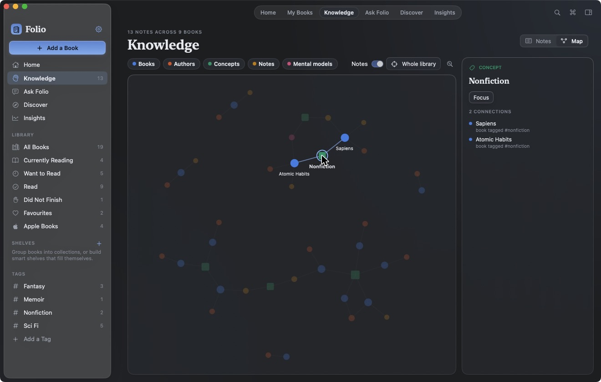<br><b>Knowledge map:</b> how books, ideas and notes connect.</td>
<td>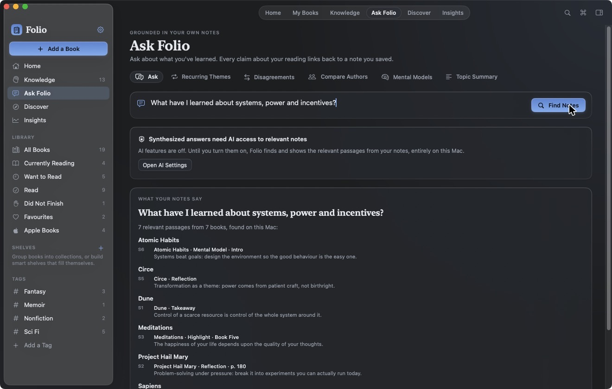<br><b>Ask Folio:</b> answers from your own notes. With AI off, it shows the evidence it found.</td>
</tr>
<tr>
<td>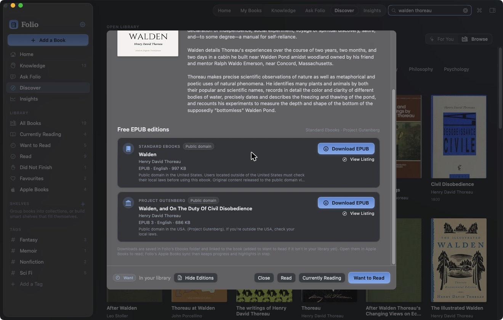<br><b>Find EPUB:</b> free, legal editions inside the Discover book sheet.</td>
<td>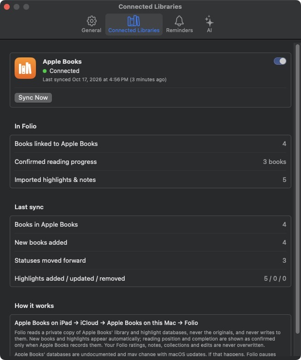<br><b>Connected Libraries:</b> sync status, last sync and the read-only guarantee.</td>
</tr>
</table>

## Features

### Available

- **Library:** cover gallery, kanban board and sortable list. Faceted filters, collections, rule-based smart shelves, tags, rereads, and finish forecasts.
- **Reading sessions and insights:** a timer and manual logging; pace, streaks, monthly charts, genres, completion rate, a yearly heatmap, and forecasts with ranges.
- **Knowledge vault:** highlights, quotes, reflections, lessons, mental models and questions. Markdown editing with autosave, and note-to-note connections.
- **Search:** keyword search plus on-device semantic search (Apple NaturalLanguage) across books and notes.
- **Knowledge map:** an interactive graph of books, concepts and notes.
- **Apple Books sync (read-only):** automatic import of books, confirmed progress, completion and highlights. [Details below.](#apple-books-sync)
- **Find EPUB:** free public-domain editions from Standard Ebooks and Project Gutenberg, with a validated download manager. [Details below.](#free-epubs)
- **Discover:** Open Library browsing, plus AI recommendations, each checked against Open Library before it's shown.
- **Ask Folio:** answers grounded in your notes. Citations and quotes are checked against the vault, and personal evidence, book information and general knowledge are labelled separately.
- **Mac-native:** a ⌘K command palette, keyboard shortcuts, drag and drop, reading reminders, light and dark appearance, Reduce Motion support, and VoiceOver labels.
- **Your data:** Goodreads CSV import and export, full JSON backup and restore, Markdown export (Obsidian-friendly), and optional daily iCloud Drive backups.

### Experimental

- Cross-book synthesis in Ask Folio (compare, trace an idea, find tensions). It works, but quality depends on how many notes you have.
- Apple Books chapter titles, notes attached to highlights, and live iPad-to-Mac timing (see [the details](docs/apple-books-sync.md#verification-status)).

## Apple Books sync

Folio reads Apple Books' library on your Mac and keeps Folio up to date automatically. It is **strictly read-only**: Folio reads private snapshot copies and never writes to Apple's files.

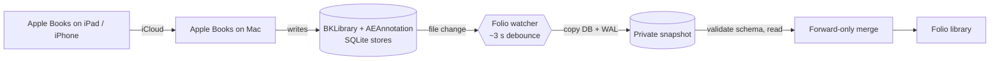

| Verified on real data | Experimental | Not supported |
|---|---|---|
| Book import and dedupe | Chapter titles for highlights | Page numbers (Apple stores positions, not pages) |
| Confirmed progress percentage | Notes attached to highlights | Start dates and reading sessions |
| Finished flag and finish date | Live iPad → Mac timing | "Last opened" dates |
| Highlights with source attribution | | Audiobooks and samples |
| Status that only moves forward; your edits are never overwritten | | Writing back to Apple Books |

Progress from Apple Books is labelled **Confirmed by Apple Books**, separately from progress you logged in Folio. Folio never invents start dates or reading sessions. Full details are in [docs/apple-books-sync.md](docs/apple-books-sync.md).

## Free EPUBs

Open any book in **Discover** and choose **Find EPUB**. Folio searches **Standard Ebooks** and **Project Gutenberg** by title, author or ISBN, lists the matching editions with their format, language, size and licence, and downloads them with progress, retries, cancellation, EPUB validation and duplicate detection. Downloaded files are linked to the book and can be opened in Apple Books.

> Folio only lists public-domain editions from these catalogs. Shadow libraries such as Anna's Archive are deliberately **not** supported, because they mostly distribute copyrighted books without permission.

## Roadmap

| Available now | In development | Planned |
|---|---|---|
| Library, sessions, insights | Richer Apple Books progress (chapter-aware) | Audible / audiobook import |
| Knowledge vault and map | More open-licence EPUB catalogs | Multi-Mac iCloud sync |
| AI discovery and Ask Folio | | Kindle highlight import |
| Apple Books sync (read-only) | | Shortcuts and Spotlight integration |
| Find EPUB | | Widgets |

See [FOLIO_ROADMAP.md](FOLIO_ROADMAP.md) for the milestone log and known limitations.

## Getting started

You need macOS 14+ and the Xcode Command Line Tools (`xcode-select --install`). The full Xcode app isn't required.

```bash
gh repo clone LibanTheDev/folio-mac && cd folio-mac
./build_app.sh && open Folio.app
swift test
```

To try Folio with sample data and a synthetic Apple Books store, without touching your own library:

```bash
python3 scripts/make_demo.py /tmp/folio-demo
open -n --env FOLIO_DATA_DIR=/tmp/folio-demo/library --env FOLIO_APPLE_BOOKS_DIR=/tmp/folio-demo/applebooks Folio.app
```

Live tests that use the network, your real Apple Books data (read-only) or an AI key are opt-in. See [docs/development.md](docs/development.md).

## Privacy and security

- **Local first.** Everything is stored in `~/Library/Application Support/Folio/`. No account, telemetry or analytics.
- **AI is off by default.** You choose the provider (Anthropic, or any OpenAI-compatible server including local Ollama). Keys are stored in the macOS Keychain. Separate switches control whether metadata and notes may be sent, and only the passages relevant to a question are sent.
- **Read-only integrations.** Apple Books is read from snapshot copies, and its files are never modified.
- **Network use** is limited to Open Library, the EPUB catalogs you search, and the AI provider you enable.

## Documentation

- [Architecture](docs/architecture.md)
- [Apple Books sync](docs/apple-books-sync.md)
- [Development](docs/development.md)
- [Roadmap and milestone log](FOLIO_ROADMAP.md)
